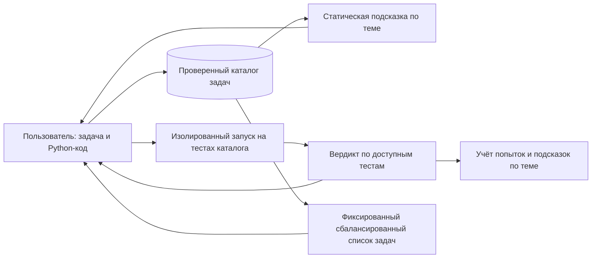
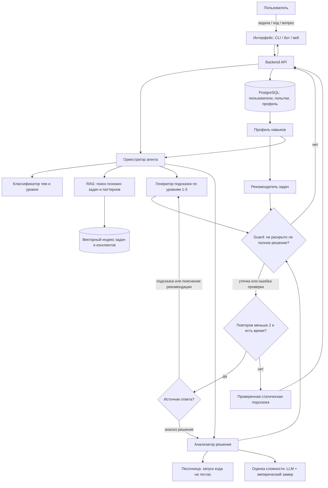

# ML System Design Doc — AlgoMind

> Версия 0.2
> Нумерация: [шаблон Reliable ML](https://github.com/IrinaGoloshchapova/ml_system_design_doc_ru/blob/main/ML_System_Design_Doc_Template.md). Параметры пилота — плановые допущения до набора участников.

## 1. Цели и предпосылки

### 1.1. Зачем идём в разработку продукта?

#### Бизнес-цель

Подготовка к алгоритмическим секциям собеседований (LeetCode-подобные задачи) - массовая потребность разработчиков. Существующие подходы имеют системные проблемы:

| Подход | Проблема |
|---|---|
| Решебники / разборы на LeetCode, YouTube | Читаешь готовое решение -> иллюзия понимания, навык не формируется |
| Общий чат-бот (ChatGPT и т.п.) | Выдаёт ответ сразу, не ведёт диалог-обучение, не помнит прогресс, может уверенно ошибаться в сложности |
| Репетитор / менторство | Дорого и плохо масштабируется |
| Самостоятельная практика | Нет обратной связи, непонятно, какие темы проседают |

**Цель продукта:** превратить подготовку из «прочитал ответ» в «понял логику и закрепил навык» — с персонализацией по слабым местам.

#### Почему станет лучше от применения ML

- LLM способна вести **сократический диалог**: оценивать, где пользователь запутался, и давать подсказку нужной глубины — классическими правилами это не закодировать.
- Анализ **произвольного кода пользователя** (идея, баги, граничные случаи, сложность) — задача понимания кода.
- Классификация задач и ошибок по **темам/паттернам** позволяет строить профиль навыков и персональный план.

#### Что считается успехом (продуктовые и ML-метрики)

| Уровень | Метрика | Целевое значение (MVP) |
|---|---|---|
| Продукт | Доля пользователей, решивших задачу самостоятельно с подсказками (без показа полного решения) | ≥ 60 % |
| Продукт | Дополнительный рост решаемости по исходной слабой теме относительно контроля за 2 недели (разность изменений, п. 3.1) | ≥ 15 п.п. |
| Продукт | Retention D7 | ≥ 25 % |
| ML | Точность определения временной/пространственной сложности (на размеченном наборе) | ≥ 85 % |
| ML | Доля подсказок, не раскрывающих полное решение (LLM-judge + ручная проверка выборки) | ≥ 95 % |
| ML | Доля сессий, в которых подсказки вместе не раскрывают полное решение (ручная проверка выборки сессий) | ≥ 90 % |
| ML | Доля заведомо неверных решений (мутантов), пропущенных тестами каталога, по каждому типу дефекта | ≤ 5 % |
| ML | Определение тем задачи (multi-label, macro F1 по темам) | ≥ 0.6, уточняется после замера бейзлайна |
| ML | Доля корректных вердиктов о правильности решения пользователя (с учётом запуска тестов) | ≥ 90 % |

### 1.2. Бизнес-требования и ограничения

#### Бизнес-требования

1. Пользователь вводит условие задачи (текст/ссылка) и получает **пошаговое сопровождение**: уточнение условия -> идея -> структура данных -> алгоритм -> реализация.
2. Уровень подсказки **регулируется**: по умолчанию - наводящие вопросы; полное решение выдаётся только по явному запросу после попыток.
3. Для любого решения пользователя система выдаёт **оценку сложности** (time/space) с обоснованием и указывает более оптимальные подходы.
4. Система хранит историю и строит **профиль навыков** по темам (массивы, графы, DP, жадные, два указателя и т.д.).
5. Система рекомендует **следующие задачи** под уровень и слабые места.
6. Поддержка русского и английского языков, языки кода - Python, затем другие.
7. Проверить пользу персонального плана в пилоте на выборке из 40 участников — студентов старших курсов и начинающих Python-разработчиков, готовящихся к алгоритмическим собеседованиям. Критерии успеха и схема пилота — п. 3.

#### Бизнес-ограничения

| Ограничение | Значение / допущение |
|---|---|
| Бюджет на инференс | ≤ $0.10 на сессию разбора одной задачи в среднем; расчёт ниже |
| Латентность | p95 времени до показа проверенной подсказки ≤ 15 с; общий дедлайн 15 с, затем статический ответ |
| Команда | учебный проект, 1 разработчик, срок — семестр курса |
| Данные | только открытые/легальные источники условий задач; не копируем закрытые базы платных платформ |
| Приватность | код и история пользователя не передаются третьим лицам, кроме LLM-провайдера; хранение — с возможностью удаления |
| Безопасность | исполнение пользовательского кода только в изолированной песочнице с лимитами CPU/RAM/времени и без сети |
| Надёжность | допустима деградация: при недоступности LLM — отдаём статические подсказки/теги из базы |

#### Оценка стоимости сессии

Сессия — разбор одной задачи, планово 6 ответов. Генератор и guard — Haiku 4.5, $1 / млн входных и $5 / млн выходных токенов ([Claude API pricing](https://platform.claude.com/docs/en/about-claude/pricing), проверено 04.11.2026). Расчёт без скидок за кэширование:

| Вызовы за сессию | Входные токены | Выходные токены | Стоимость |
|---|---:|---:|---:|
| 6 генераций: по 4 000 входных (инструкции, условие, RAG, код, история) и 400 выходных | 24 000 | 2 400 | $0.036 |
| 6 guard-проверок: по 2 500 входных (ответ и накопленные подсказки сессии) и 100 выходных | 15 000 | 600 | $0.018 |
| Классификация и итоговый анализ суммарно | 5 000 | 1 000 | $0.010 |
| Итого без повторов | 44 000 | 4 000 | $0.064 |

Повторная пара «генерация + guard» стоит $0.009: две пары на сессию дают $0.082, по две на каждый из шести ответов — $0.172. Поэтому целью выбрано среднее $0.10 вместо исходных $0.05. Это оценка, а не замер: история и код могут быть длиннее. В пилоте считаем фактические токены, повторы и ошибки, среднее и p95 стоимости; длинные сессии показываем отдельно. Песочница, БД и индекс учитываются отдельно.

#### Что считается «успешным MVP»

Пользователь решает 3 задачи подряд, получая только подсказки, и после этого видит корректный профиль слабых тем.

#### Риски

| Риск | Митигация |
|---|---|
| Галлюцинации в оценке сложности / ложный вердикт | Проверка решения запуском тестов в песочнице; эталонные решения и сложность для задач из базы; self-consistency |
| «Протекание» полного решения в подсказке | Многоуровневая система подсказок, guard-проверка выхода с учётом накопленных подсказок сессии (LLM-judge), тесты на утечку |
| Задача пользователя вне базы -> нет эталона | Генерация тестов + сверка с несколькими независимыми решениями LLM; пометка «низкая уверенность» |
| Рост стоимости | Кэширование, маршрутизация простых запросов на меньшую модель |
| Небезопасный код пользователя | Песочница (контейнер, seccomp, без сети, лимиты) |

### 1.3. Что входит в скоуп проекта / итерации, что не входит

#### Итерация 1 (MVP, текущая)

**Входит:**
- Диалоговый разбор одной задачи с тремя уровнями подсказок (направление -> идея/структура данных -> псевдокод).
- Разбор решения пользователя на Python: корректность (запуск на тестах), оценка time/space сложности, граничные случаи.
- Базовая база задач (~100–200 задач) с тегами тем, сложностью и эталонной оценкой.
- Простой профиль навыков (статистика попыток и подсказок по темам) и подбор задач по слабой теме для пилота.
- Интерфейс: CLI или Telegram-бот / простое веб-приложение (уточняется).
- Набор для оффлайн-оценки качества (golden set) и отчёт по метрикам.

**Не входит (в этой итерации):**
- Mock-интервью с голосом/видео и оценкой soft skills.
- System design и behavioral-секции собеседований.
- Языки кроме Python.
- Интеграция с LeetCode/Codeforces через API и автоимпорт истории посылок.
- Мобильное приложение, платежи, соцфункции (рейтинги, друзья).
- Дообучение собственных моделей (используем готовые LLM + промптинг/RAG).

#### Дальнейшие итерации (roadmap)

1. Итерация 2: расширение адаптивного плана тренировок, spaced repetition по паттернам.
2. Итерация 3: дополнительные языки, mock-интервью в текстовом формате.
3. Итерация 4: интеграции с внешними платформами, персонализация на основе эмбеддингов задач.

### 1.4. Предпосылки решения

#### Источники данных

| Данные | Источник | Назначение |
|---|---|---|
| Условия, теги, сложность задач | Открытые датасеты (напр. наборы задач Codeforces/открытые LeetCode-подобные датасеты на HuggingFace), собственная разметка | База задач, RAG, рекомендации |
| Эталонные решения и тесты | Открытые решения, собственные + проверка запуском | Верификация, оценка сложности |
| Логи сессий пользователей | Собственный продукт | Профиль навыков, оценка качества, улучшение подсказок |
| Размеченные примеры «код -> сложность» | Ручная разметка + синтетика с проверкой | Оценка точности модуля сложности |

#### Технические предпосылки

- Основа — **LLM через API** (Claude Haiku 4.5 (`claude-haiku-4-5-20251001`, кандидат для пилота; допуск после итоговой оценки на holdout)) с промпт-инжинирингом и tool use; обучение с нуля не требуется.
- **RAG** по базе задач и конспектам алгоритмов/паттернов: поиск похожих задач и типовых приёмов.
- **Песочница** для запуска кода (Docker/gVisor, лимиты) — источник «ground truth» для корректности.
- Хранилище: PostgreSQL (пользователи, попытки, профиль) + векторный индекс (pgvector / Qdrant) для поиска задач.
- Python-стек: FastAPI/aiogram, pydantic, pytest, ruff, pre-commit.

#### Допущения

- Пользователь готов вести диалог, а не получать мгновенный ответ.
- Качества современных LLM достаточно для разбора задач уровня Easy–Medium; Hard — с пониженной уверенностью.
- Оценка сложности может проверяться эмпирически (замер роста времени на входах разного размера) в дополнение к LLM-анализу.

#### Близкий аналог

[CS50.ai / CS50 Duck](https://cs50.readthedocs.io/cs50.ai/) направляет студента к ответу без выдачи готового решения. Статья [Teaching CS50 with AI (SIGCSE 2024)](https://cs.harvard.edu/malan/publications/V1fp0567-liu.pdf) описывает внедрение на курсе и обратную связь студентов. Это пример применимости формата, но не доказательство эффекта персонального плана AlgoMind: аудитория и задачи отличаются, нужен собственный контролируемый пилот.

#### Бейзлайны для сравнения

1. Общий чат-бот без специального промпта («реши задачу»).
2. Тот же LLM + системный промпт «подсказывай, не раскрывая решения» без RAG и верификации.
3. Правила на тегах (статические подсказки по теме).

## 2. Методология

### 2.1. Постановка задачи

#### Формальная постановка

Система — композиция нескольких ML-задач вокруг LLM:

1. **Генерация подсказки уровня *k***. Вход: условие задачи *P*, история диалога *H*, код пользователя *C* (опц.), уровень подсказки *k* ∈ {1,2,3}. Выход: текст *h*, который продвигает пользователя, но не раскрывает решение выше уровня *k*.
2. **Оценка решения.** Вход: *P*, *C*. Выход: вердикт (верно / неверно / неоптимально), список проваленных граничных случаев, оценка сложности (T, S) с обоснованием, замечания.
3. **Классификация темы/паттерна.** Вход: *P* и/или *C*. Выход: множество тегов тем (multi-label).
4. **Оценка уровня навыка.** Вход: история попыток пользователя. Выход: вектор уверенности по темам *s ∈ [0,1]^T*.
5. **Рекомендация следующей задачи.** Вход: профиль *s*, база задач. Выход: ранжированный список задач с целевой сложностью около «зоны ближайшего развития».

#### Тип задачи

Условная генерация текста (LLM + RAG), классификация (multi-label), оценка кода по ground truth из исполнения, ранжирование/рекомендации.

#### Критерии качества и валидация

- **Оффлайн — настройка:** golden set из ~100 задач с размеченными тегами, эталонной сложностью и типичными ошибочными решениями используем для выбора модели, промптов, RAG и guard, а также регрессионных проверок. Результат на нём не считаем итоговой оценкой качества.
- **Оффлайн — итоговая оценка:** отдельный holdout из ~50 других задач с тем же составом разметки и покрытием тем и сложности. Разбиение фиксируем до настройки и делаем по семействам задач: переформулировки, переводы, варианты и связанные решения/диалоги остаются в одном наборе. Holdout исключаем из RAG, примеров в промптах, настройки и теста пилота. После фиксации модели, промптов и конфигурации считаем на нём метрики из п. 1.1, кроме темы (LLM-judge на утечку — с ручной проверкой выборки); на том же holdout считаем бейзлайны. Если по результатам меняем систему, набор становится набором разработки, и для новой оценки нужен новый holdout. Возможное пересечение с предобучением внешней LLM остаётся ограничением.
- **Оффлайн — классификатор тем:** holdout из ~50 задач мал для метрик по темам (по EDA в нём будет около 4 задач с `two pointers` и 6 с `graphs`). Теги уже есть в данных, поэтому ручная разметка не нужна: проверяем на отдельной выборке из `default/train` (9 556 задач), не пересекающейся с golden set и holdout по семействам задач. По EDA пересечений `train` и `test` по `id`, контестам и текстам условий нет; берём контесты до 2024 года, чтобы не пересекаться с `test` по времени. Права на `train` проверяем так же, как для `test`.
- **Онлайн (пилот):** персональный план vs фиксированный набор задач при одинаковых подсказках; протокол и критерии — п. 3.
- **Регрессия:** прогон golden set при каждом изменении промптов/модели.

#### Мониторинг (план)

Доля показанных полных решений, доля 👎, латентность, стоимость на сессию, расхождение вердикта LLM и результата тестов, дрейф распределения тем.

### 2.2. Блок-схема решения

#### Общая архитектура

**Бейзлайн** использует только задачи с проверенными правами, редакторскими тегами и тестами. Его подсказки и рекомендации не зависят от LLM:



**Основной MVP** добавляет поиск и генерацию с guard, сохраняя тот же каталог и песочницу:



#### Сценарий «разбор задачи»

```mermaid
sequenceDiagram
    participant U as Пользователь
    participant A as Агент
    Note over U,A: Все генерируемые ответы, включая анализ и рекомендации, показываются после guard; лимит повторов и дедлайн как в п. 2.2
    participant R as RAG
    participant S as Песочница
    participant D as БД

    U->>A: условие задачи
    A->>R: похожие задачи, паттерны
    A->>U: уточняющие вопросы / подсказка ур. 1
    U->>A: идея или код
    A->>S: запуск на тестах
    S-->>A: результаты, время
    A->>U: обратная связь, подсказка ур. 2-3 или оценка сложности
    A->>D: запись попытки и использованных подсказок
    D-->>A: обновлённый профиль
    A->>U: итог + рекомендация следующей задачи
```

#### Ключевые решения

- Вердикты о корректности опираются на запуск тестов, а не только на мнение модели.
- Весь генерируемый текст (подсказки, анализ, рекомендации) проверяется и буферизуется: пользователь не видит непроверенных фрагментов.
- До двух повторных генераций (три попытки); повтор идёт к источнику отклонённого ответа. Для рекомендации перегенерируем только пояснение (задача сохраняется), для анализа — результаты песочницы и вердикт по тестам не меняются.
- Guard видит не только текущий ответ, но и накопленные подсказки сессии: несколько допустимых по отдельности подсказок могут вместе раскрыть решение. Ответ отклоняется, если по подсказкам сессии (без кода пользователя) можно восстановить рабочее решение.
- Общий дедлайн 15 с включает RAG, генерации и проверки.
- При исчерпании повторов или времени и при недоступности LLM — проверенная статическая подсказка по теме (без темы — общий наводящий вопрос). Отклонённый текст не показываем.
- **Профиль навыков** — отдельный компонент, не зависящий от конкретной LLM.

### 2.3. Этапы решения задачи

#### Этап 1. Подготовка данных

План: взять набор задач Codeforces [open-r1/codeforces](https://huggingface.co/datasets/open-r1/codeforces) (HuggingFace, `default/test`, 468 задач), удалить дубли по `id` и тексту условия, нормализовать теги, добавить собственную разметку сложности решения и допустимой глубины подсказки. Результаты EDA, графики и способ воспроизведения — в [отчёте](../eda/README.md).

Выводы EDA:
- структура чистая, дублей нет, рейтинг и теги пропущены у 2 % и 1 % задач;
- полные официальные тесты есть только у 21 из 468 задач, editorial нет у 44 %;
- темы распределены неравномерно, пересекаются умеренно; 83 % задач 2024 года.

| Сущность | Источник | Проблема и решение |
|---|---|---|
| Задача: условие, теги, рейтинг | Датасет Codeforces | Редкие пропуски. Теги нормализуем, задачи без тегов не используем для оценки классификатора |
| Тесты | Датасет Codeforces | Полнота низкая. Добавляем граничные тесты вручную |
| Сложность решения (time/space), глубина подсказки | В датасете нет | Ручная разметка двумя ревьюерами с проверкой согласия (ниже) |
| Попытки и диалоги пользователей | Логи продукта | Пока нет. Собираем в пилоте: ID задачи, код, результат тестов, число и уровень подсказок |

Задачи — статичный датасет, обновляется вручную, регулярного потока нет. Попытки и диалоги поступают из продукта по мере использования.

**Разметка.** Перед разметкой всего набора два ревьюера независимо размечают 30 задач, считаем каппу Коэна (для сложности - и долю точного совпадения). Цель для модели — совпадение с экспертом от 85 % (п. 1.1); если эксперты согласны реже, метрика не отличит хорошую модель от плохой. В этом случае сначала уточняем критерии (например, O(n log n) против O(n log² n), амортизированные оценки), потом размечаем остальное.

Набор `default/test` исследовательский: авторы просят не обучаться на нём, права на коммерческое использование не проверены. Поэтому подтверждённый объём для продукта сейчас 0. До пилота нужно примерно 275–375 непересекающихся задач: 100–200 для практики, ~100 для настройки (golden set), ~50 для итоговой оценки (holdout) и 24 для проверки навыка в пилоте (3 задачи на каждую из 4 тем до и после практики, п. 3.1; выровнены по сложности, не пересекаются с практикой и RAG). Источники: собственные задачи и наборы с подходящей лицензией. По EDA в `default/test` по темам пилота в диапазоне рейтинга 1200–1999 всего 22 задачи на `two pointers`, 23 на `graphs` и 32 на `dp`, этого мало. В `default/train` таких задач 251, 291 и 625 (и 463 на `sortings`), поэтому после проверки прав он может быть основным источником. Ниже рейтинга 1200 задач по `graphs` (16) и `two pointers` (38) мало даже в `train`, там нужны собственные задачи.

В задачах персональных данных нет. Код и диалоги пользователей могут содержать секреты: перед отправкой в LLM удаляем явные идентификаторы и секреты, даём возможность удалить историю.

Каталог задач с тегами, тестами и разметкой, разбитый на непересекающиеся наборы: практика, golden set, holdout, проверка навыка в пилоте. Связанные задачи (переводы, варианты) попадают в один набор.

#### Этап 2. Подготовка прогнозных моделей и бейзлайнов

Обучение своей модели в MVP не планируется: используем готовую LLM и правила, а модель и промпты выбираем по метрикам.

**Метрики:**
- подсказка: доля подсказок без утечки полного решения и отдельно доля сессий без утечки (единица проверки — сессия, а не только подсказка), доля самостоятельных решений, ручная оценка полезности;
- проверка кода: accuracy вердикта на скрытых тестах, отдельно доля пропущенных мутантов (ложных «верно», см. ниже);
- сложность: совпадение time/space с экспертной меткой, матрица ошибок;
- теги: precision, recall и F1 по каждой теме, micro и macro F1 (цель — macro F1, п. 1.1);
- рекомендации: решаемость по слабой теме в пилоте.

Целевые пороги — в п. 1.1 и 3.2, стоимость и p95 задержки — обязательные ограничения.

**Валидация.** Настройка промптов и модели — на golden set, один итоговый прогон на holdout; темы оцениваем отдельно на выборке из `default/train` (подробности в п. 2.1). Фиксируем seed, версии каталога, промптов и модели. Результаты показываем по темам и сложности.

**Ложные «верно».** Для каждой задачи golden set и holdout берём проверенное решение и три мутанта с известным дефектом: off-by-one, граничный ввод (пустой или предельный), реализация хуже допустимой сложности (TLE). Метрика — доля мутантов, пропущенных тестами каталога, по типам дефектов; цель ≤ 5 % (п. 1.1). Мутанты, оставшиеся корректными, исключаем после ручной проверки. Если тесты пропускают больше, дописываем граничные тесты до использования набора как ground truth.

**Утечка по сессиям.** Сессия считается утечкой, если по накопленному тексту подсказок (без кода пользователя) можно восстановить рабочее решение. Оцениваем выборку сессий вручную и LLM-judge по всему диалогу; долю утечек в сессиях и в отдельных подсказках показываем отдельно.

**Интерпретация и разбор ошибок.** Чтобы было видно, почему подсказка или оценка вышла такой, сохраняем для каждого запроса вход, найденный паттерн, версии промпта и модели, ответ и вердикт guard. По этим логам строим матрицу ошибок по темам для классификатора и по классам сложности (O(n), O(n log n), O(n²) и т. д.) для оценки сложности. Потом вручную разбираем провалы: 20–30 худших случаев по каждому компоненту (утечка, неверная тема, неверная сложность, пропущенный мутант) и относим к причинам: неточный паттерн из RAG, слабый промпт, ошибка guard, дефект каталога. Доли причин определяют, что чинить первым.

**Порядок сравнения.** Сначала меряем бейзлайны (статические подсказки, общий чат-бот, LLM с инструкцией) и фиксируем нижнюю границу. Затем на golden set сравниваем Claude Haiku 4.5 (основной кандидат по стоимости) и более сильную модель как верхнюю оценку качества, на одном промпте. Потом при выбранной модели меняем промпты по одному: базовая инструкция, + условие и попытка, + паттерн из RAG, + guard. Каждое усложнение остаётся, только если улучшает метрику и укладывается в стоимость и задержку (п. 1.2). Лучшая конфигурация один раз прогоняется на holdout; если сильная модель заметно лучше, а Haiku не проходит пороги, пересматриваем бюджет, а не подбираем под holdout.

| Компонент | Бейзлайн | Основной MVP |
|---|---|---|
| Подсказка | Статическая подсказка по теме; общий чат-бот; та же LLM с инструкцией не раскрывать ответ | LLM с условием, попыткой и найденным паттерном; уровни 1–3, guard, до двух повторов |
| Анализ кода | Результат тестов и сохранённая сложность из каталога | Те же тесты плюс LLM-объяснение; вердикт тестов не меняется мнением LLM |
| Темы и рекомендации | Редакторские теги, фиксированный список задач | Multi-label классификация, профиль по истории попыток, ранжирование по слабой теме |

**Риски.** Редкие темы дают шумные метрики, слабые тесты дают ложные «верно», LLM-judge может повторять ошибки генератора, поэтому выборку проверяем вручную. Если MVP не превосходит бейзлайн при ограничениях по стоимости и задержке, усложнение в пилот не берём.

**Результат этапа.** Таблица метрик и затрат по вариантам, разбор ошибок, зафиксированная конфигурация кандидата.

#### Этап 3. Интеграция безопасного разбора задачи

Бейзлайн: выбор задачи → статическая подсказка → запуск Python в песочнице → запись попытки. MVP: задача и история → поиск по каталогу → генерация → guard → ответ; код запускается в той же песочнице. Песочница: контейнер без сети, с лимитами CPU, памяти и времени; проверяем бесконечный цикл, расход памяти, доступ к файлам и сети. При сбое или таймауте LLM отдаём только проверенный статический ответ. Результат этапа — рабочий сценарий разбора трёх задач, измеренные p95 до ответа и стоимость сессии.

#### Этап 4. Профиль, рекомендации и подготовка пилота

Бейзлайн выдаёт следующую задачу из фиксированного списка, MVP учитывает успешность, число подсказок и сложность, исключая решённые и тестовые задачи. Профиль пересчитывается после каждой попытки. На заранее заданных историях проверяем, что профиль отражает слабую тему, а рекомендации не повторяют решённые задачи и не включают holdout. Затем фиксируем конфигурацию, делаем итоговую оценку на holdout и проверку безопасности и запускаем пилот по п. 3. Результат этапа — решение о допуске к пилоту.

## 3. Подготовка пилота

### 3.1. Способ оценки пилота

- **Пользователи:** 40 добровольцев из учебных сообществ, знающих основы Python, но не решающих уверенно Medium. Рандомизация по пользователям с балансировкой по входному результату, две группы по 20. Это разведочный пилот; размер пока не обоснован расчётом мощности.
- **Срок:** 4 недели: первая — набор и входная диагностика, вторая и третья — практика по 3 задачи в неделю, четвёртая — итоговая проверка и анализ. Диагностика завершается до рандомизации.
- **Процесс:** обе группы получают одинаковые интерфейс, сократические подсказки, guard и время практики. Экспериментальная группа получает задачи по слабой теме входной диагностики, контрольная — фиксированный сбалансированный набор без персонального плана. Слабую тему фиксируем до практики и не перевыбираем по итоговым результатам.
- **Проверка навыка:** до и после практики каждый решает по 3 задачи на каждую из четырёх тем (сортировки, два указателя, графы, DP) рейтинга Codeforces 1200–1999, без тьютора и внешних решений, с одинаковым лимитом времени. Для массивов в Codeforces нет тега, ближайшая тема — `sortings`. Разные формы заранее выравниваем по сложности, порядок форм балансируем между группами; тестовые задачи исключаем из практики и RAG. Успех задачи — прохождение скрытых тестов в песочнице.
- **Основная метрика:** для каждого участника считаем изменение доли решённых тестовых задач по исходной слабой теме. Эффект = среднее изменение в экспериментальной группе минус среднее изменение в контроле. Контроль учитывает общий эффект практики и регрессию к среднему. Показываем 95 % доверительный интервал с бутстрэпом по пользователям; попытки не считаем независимыми участниками.
- **Другие метрики:** доля участников экспериментальной группы, решивших хотя бы одну задачу практики с подсказками без полного ответа (знаменатель — все назначенные в группу); D7 — возврат на 7-й день после первой практики среди начавших; утечки, стоимость и задержка. Отток и пропуски показываем по группам. В основном консервативном расчёте пропущенные итоговые задачи считаем нерешёнными; отдельно приводим анализ по завершившим.

### 3.2. Что считаем успешным пилотом

Переходим к расширенному пилоту при одновременном выполнении условий:

1. Разность изменений ≥ 15 п.п., нижняя граница 95 % интервала выше нуля.
2. Решаемость с подсказками ≥ 60 %, D7 ≥ 25 % в экспериментальной группе.
3. Выполнены ML-пороги из п. 1.1; все подсказки пилота и сессии целиком проверяем на утечки вручную, независимо от guard.
4. Средняя стоимость инференса ≤ $0.10 за сессию, p95 времени до проверенной или статической подсказки ≤ 15 с. Долю статических ответов показываем отдельно, чтобы задержка не скрывала деградацию.

Если интервал включает ноль или итоговую проверку прошли менее 80 % любой группы, результат неопределённый: оцениваем размер следующего эксперимента по наблюдаемой дисперсии, успех не объявляем. При нарушениях безопасности останавливаем пилот; при провале качества или бюджета дорабатываем компонент и повторяем оценку до расширения.

### 3.3. Подготовка пилота и ограничения

До набора фиксируем модель, промпты, задачи, тесты и схему рандомизации; выполняем регрессию на golden set, итоговую оценку на holdout после фиксации конфигурации и проверку изоляции песочницы. Получаем согласие на обработку кода и истории, обеспечиваем удаление данных. Разработчик отвечает за набор, поддержку и ручную проверку. Результат — метрики по группам с интервалами, затраты и решение о следующей итерации. Коммерческую эффективность и долгосрочное сохранение навыка этот пилот не устанавливает.
