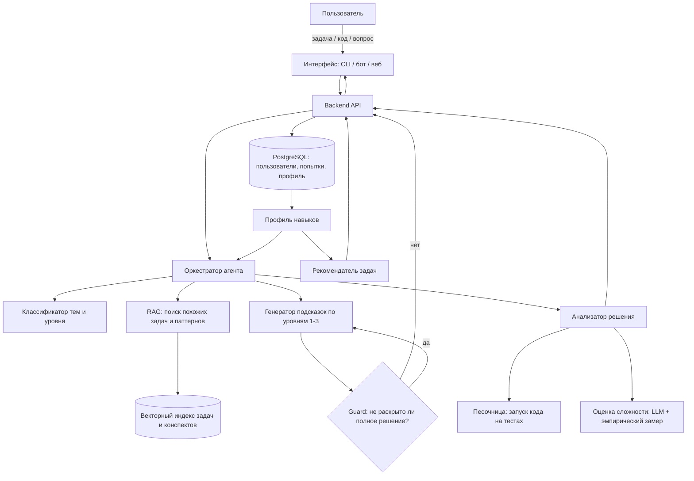
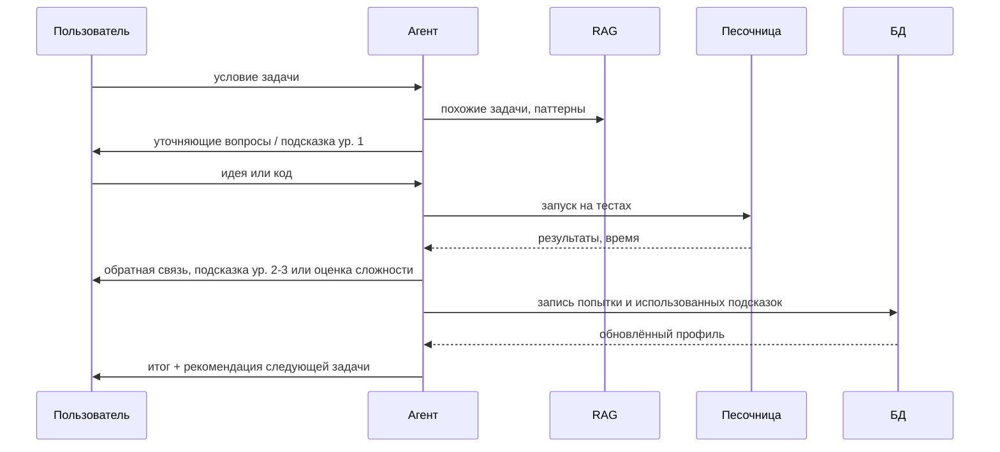

# ML System Design Doc — AlgoMind

> Версия 0.1

## 1. Зачем нужен продукт?

### 1.1. Бизнес-цель

Подготовка к алгоритмическим секциям собеседований (LeetCode-подобные задачи) - массовая потребность разработчиков. Существующие подходы имеют системные проблемы:

| Подход | Проблема |
|---|---|
| Решебники / разборы на LeetCode, YouTube | Читаешь готовое решение -> иллюзия понимания, навык не формируется |
| Общий чат-бот (ChatGPT и т.п.) | Выдаёт ответ сразу, не ведёт диалог-обучение, не помнит прогресс, может уверенно ошибаться в сложности |
| Репетитор / менторство | Дорого и плохо масштабируется |
| Самостоятельная практика | Нет обратной связи, непонятно, какие темы проседают |

**Цель продукта:** превратить подготовку из «прочитал ответ» в «понял логику и закрепил навык» — с персонализацией по слабым местам.

### 1.2. Почему станет лучше от применения ML

- LLM способна вести **сократический диалог**: оценивать, где пользователь запутался, и давать подсказку нужной глубины — классическими правилами это не закодировать.
- Анализ **произвольного кода пользователя** (идея, баги, граничные случаи, сложность) — задача понимания кода.
- Классификация задач и ошибок по **темам/паттернам** позволяет строить профиль навыков и персональный план.

### 1.3. Что считается успехом (продуктовые и ML-метрики)

| Уровень | Метрика | Целевое значение (MVP) |
|---|---|---|
| Продукт | Доля пользователей, решивших задачу самостоятельно с подсказками (без показа полного решения) | ≥ 60 % |
| Продукт | Рост доли решённых задач по «слабой» теме за 2 недели | +15 п.п. |
| Продукт | Retention D7 | ≥ 25 % |
| ML | Точность определения временной/пространственной сложности (на размеченном наборе) | ≥ 85 % |
| ML | Доля подсказок, не раскрывающих полное решение (LLM-judge + ручная проверка выборки) | ≥ 95 % |
| ML | Точность определения темы задачи/ошибки (accuracy по тегам) | ≥ 80 % |
| ML | Доля корректных вердиктов о правильности решения пользователя (с учётом запуска тестов) | ≥ 90 % |

## 2. Бизнес-требования и ограничения

### 2.1. Бизнес-требования

1. Пользователь вводит условие задачи (текст/ссылка) и получает **пошаговое сопровождение**: уточнение условия -> идея -> структура данных -> алгоритм -> реализация.
2. Уровень подсказки **регулируется**: по умолчанию - наводящие вопросы; полное решение выдаётся только по явному запросу после попыток.
3. Для любого решения пользователя система выдаёт **оценку сложности** (time/space) с обоснованием и указывает более оптимальные подходы.
4. Система хранит историю и строит **профиль навыков** по темам (массивы, графы, DP, жадные, два указателя и т.д.).
5. Система рекомендует **следующие задачи** под уровень и слабые места.
6. Поддержка русского и английского языков, языки кода - Python, затем другие.

### 2.2. Бизнес-ограничения

| Ограничение | Значение / допущение |
|---|---|
| Бюджет на инференс | ≤ $0.05 на сессию разбора одной задачи (в среднем) |
| Латентность | первый токен ответа ≤ 3 с; полный ответ-подсказка ≤ 15 с |
| Команда | учебный проект, 1 разработчик, срок — семестр курса |
| Данные | только открытые/легальные источники условий задач; не копируем закрытые базы платных платформ |
| Приватность | код и история пользователя не передаются третьим лицам, кроме LLM-провайдера; хранение — с возможностью удаления |
| Безопасность | исполнение пользовательского кода только в изолированной песочнице с лимитами CPU/RAM/времени и без сети |
| Надёжность | допустима деградация: при недоступности LLM — отдаём статические подсказки/теги из базы |

### 2.3. Что считается «успешным MVP»

Пользователь решает 3 задачи подряд, получая только подсказки, и после этого видит корректный профиль слабых тем.

### 2.4. Риски

| Риск | Митигация |
|---|---|
| Галлюцинации в оценке сложности / ложный вердикт | Проверка решения запуском тестов в песочнице; эталонные решения и сложность для задач из базы; self-consistency |
| «Протекание» полного решения в подсказке | Многоуровневая система подсказок, guard-проверка выхода (LLM-judge), тесты на утечку |
| Задача пользователя вне базы -> нет эталона | Генерация тестов + сверка с несколькими независимыми решениями LLM; пометка «низкая уверенность» |
| Рост стоимости | Кэширование, маршрутизация простых запросов на меньшую модель |
| Небезопасный код пользователя | Песочница (контейнер, seccomp, без сети, лимиты) |

## 3. Что входит в скоуп проекта / итерации, что не входит

### 3.1. Итерация 1 (MVP, текущая)

**Входит:**
- Диалоговый разбор одной задачи с тремя уровнями подсказок (направление -> идея/структура данных -> псевдокод).
- Разбор решения пользователя на Python: корректность (запуск на тестах), оценка time/space сложности, граничные случаи.
- Базовая база задач (~100–200 задач) с тегами тем, сложностью и эталонной оценкой.
- Простой профиль навыков (статистика попыток и подсказок по темам).
- Интерфейс: CLI или Telegram-бот / простое веб-приложение (уточняется).
- Набор для оффлайн-оценки качества (golden set) и отчёт по метрикам.

**Не входит (в этой итерации):**
- Mock-интервью с голосом/видео и оценкой soft skills.
- System design и behavioral-секции собеседований.
- Языки кроме Python.
- Интеграция с LeetCode/Codeforces через API и автоимпорт истории посылок.
- Мобильное приложение, платежи, соцфункции (рейтинги, друзья).
- Дообучение собственных моделей (используем готовые LLM + промптинг/RAG).

### 3.2. Дальнейшие итерации (roadmap)

1. Итерация 2: адаптивный план тренировок, spaced repetition по паттернам.
2. Итерация 3: дополнительные языки, mock-интервью в текстовом формате.
3. Итерация 4: интеграции с внешними платформами, персонализация на основе эмбеддингов задач.

## 4. Предпосылки решения

### 4.1. Источники данных

| Данные | Источник | Назначение |
|---|---|---|
| Условия, теги, сложность задач | Открытые датасеты (напр. наборы задач Codeforces/открытые LeetCode-подобные датасеты на HuggingFace), собственная разметка | База задач, RAG, рекомендации |
| Эталонные решения и тесты | Открытые решения, собственные + проверка запуском | Верификация, оценка сложности |
| Логи сессий пользователей | Собственный продукт | Профиль навыков, оценка качества, улучшение подсказок |
| Размеченные примеры «код -> сложность» | Ручная разметка + синтетика с проверкой | Оценка точности модуля сложности |

### 4.2. Технические предпосылки

- Основа — **LLM через API** (семейство Claude / аналог) с промпт-инжинирингом и tool use; обучение с нуля не требуется.
- **RAG** по базе задач и конспектам алгоритмов/паттернов: поиск похожих задач и типовых приёмов.
- **Песочница** для запуска кода (Docker/gVisor, лимиты) — источник «ground truth» для корректности.
- Хранилище: PostgreSQL (пользователи, попытки, профиль) + векторный индекс (pgvector / Qdrant) для поиска задач.
- Python-стек: FastAPI/aiogram, pydantic, pytest, ruff, pre-commit.

### 4.3. Допущения

- Пользователь готов вести диалог, а не получать мгновенный ответ.
- Качества современных LLM достаточно для разбора задач уровня Easy–Medium; Hard — с пониженной уверенностью.
- Оценка сложности может проверяться эмпирически (замер роста времени на входах разного размера) в дополнение к LLM-анализу.

### 4.4. Бейзлайны для сравнения

1. Общий чат-бот без специального промпта («реши задачу»).
2. Тот же LLM + системный промпт «подсказывай, не раскрывая решения» без RAG и верификации.
3. Правила на тегах (статические подсказки по теме).

## 5. Постановка задачи

### 5.1. Формальная постановка

Система — композиция нескольких ML-задач вокруг LLM:

1. **Генерация подсказки уровня *k***. Вход: условие задачи *P*, история диалога *H*, код пользователя *C* (опц.), уровень подсказки *k* ∈ {1,2,3}. Выход: текст *h*, который продвигает пользователя, но не раскрывает решение выше уровня *k*.
2. **Оценка решения.** Вход: *P*, *C*. Выход: вердикт (верно / неверно / неоптимально), список проваленных граничных случаев, оценка сложности (T, S) с обоснованием, замечания.
3. **Классификация темы/паттерна.** Вход: *P* и/или *C*. Выход: множество тегов тем (multi-label).
4. **Оценка уровня навыка.** Вход: история попыток пользователя. Выход: вектор уверенности по темам *s ∈ [0,1]^T*.
5. **Рекомендация следующей задачи.** Вход: профиль *s*, база задач. Выход: ранжированный список задач с целевой сложностью около «зоны ближайшего развития».

### 5.2. Тип задачи

Условная генерация текста (LLM + RAG), классификация (multi-label), оценка кода по ground truth из исполнения, ранжирование/рекомендации.

### 5.3. Критерии качества и валидация

- **Оффлайн:** golden set из ~100 задач с размеченными тегами, эталонной сложностью, набором типичных ошибочных решений; метрики из п. 1.3; LLM-judge на утечку решения с выборочной ручной проверкой.
- **Онлайн (пилот):** A/B «сократический режим» vs «ответ сразу»; метрики — решаемость без показа ответа, retention, удовлетворённость (👍/👎).
- **Регрессия:** прогон golden set при каждом изменении промптов/модели.

### 5.4. Мониторинг (план)

Доля показанных полных решений, доля 👎, латентность, стоимость на сессию, расхождение вердикта LLM и результата тестов, дрейф распределения тем.

## 6. Блок-схема решения

### 6.1. Общая архитектура

### 6.2. Сценарий «разбор задачи»

### 6.3. Ключевые решения

- **LLM — «мозг», детерминированные проверки — «истина».** Вердикты о корректности опираются на запуск тестов, а не только на мнение модели.
- **Guard на выходе** отделяет «обучающий» режим от «решебника».
- **Профиль навыков** — отдельный компонент, не зависящий от конкретной LLM.

## 7. Прочее

### 7.1. Этапы работ

| Этап | Результат | Срок |
|---|---|---|
| 0. Сетап репозитория, дизайн-док | HW1 | до 29.10 |
| 1. База задач + golden set | датасет с тегами и тестами | — |
| 2. Диалог с подсказками + guard | работающий прототип | — |
| 3. Песочница + анализ решения + сложность | вердикты и оценка сложности | — |
| 4. Профиль и рекомендации | персональный план | — |
| 5. Оценка, пилот, отчёт | метрики vs бейзлайны | — |
