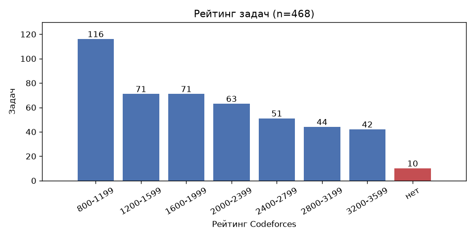
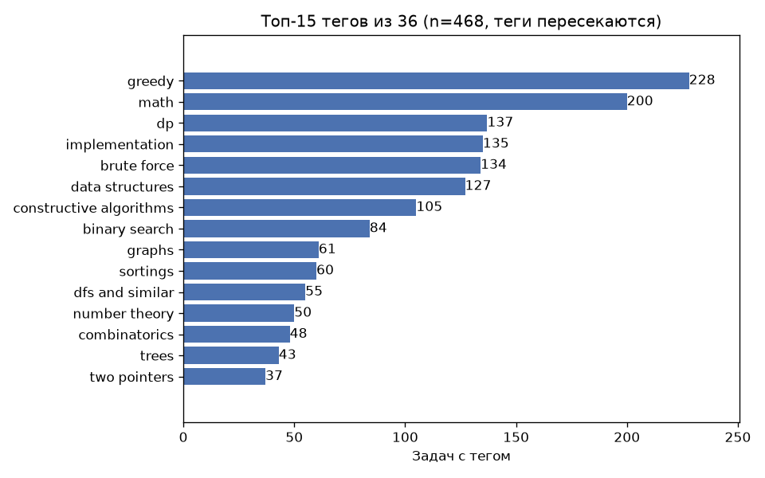
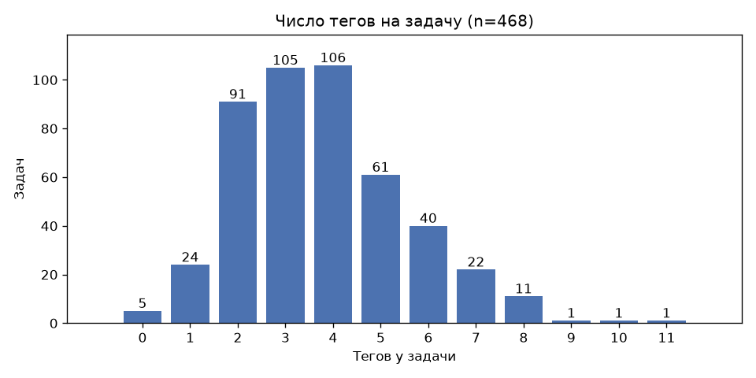
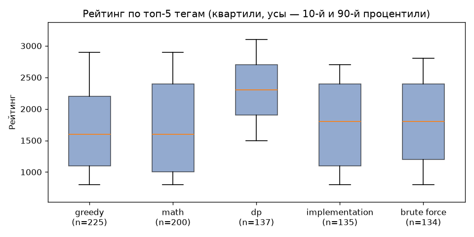
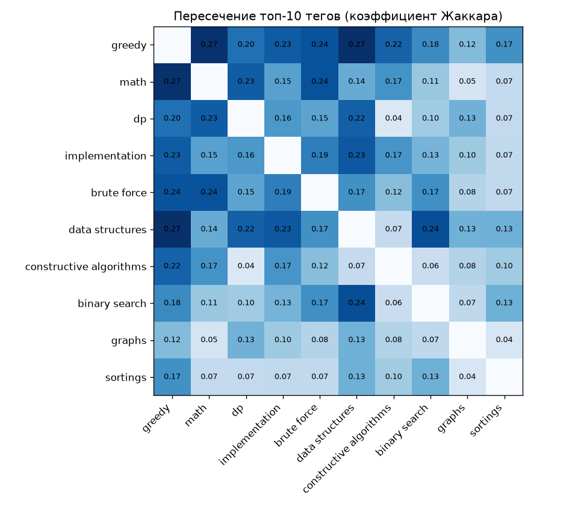
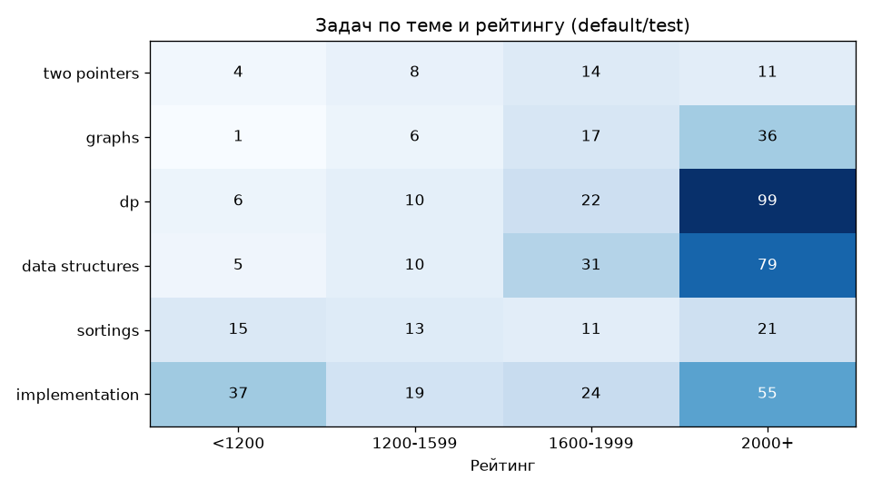
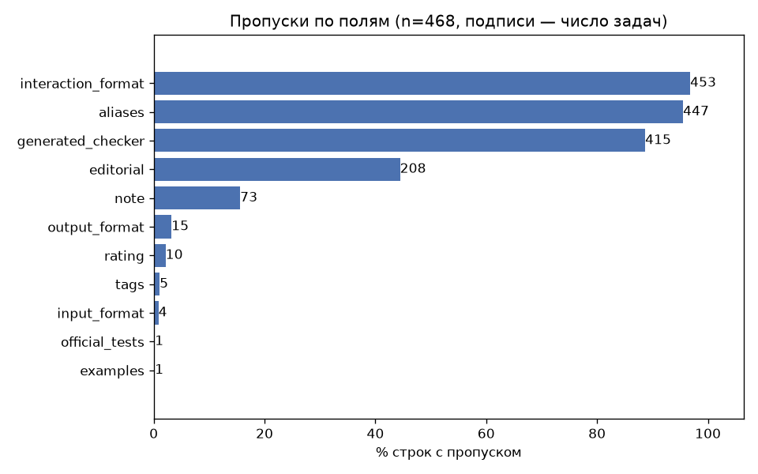
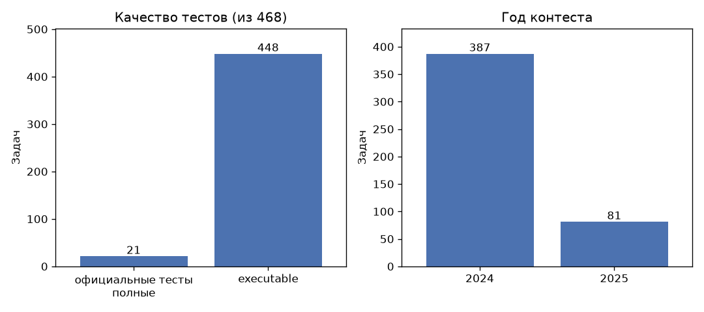
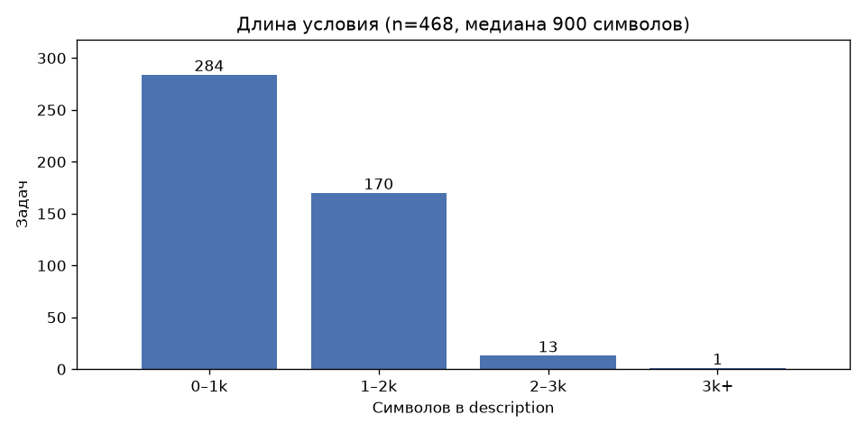
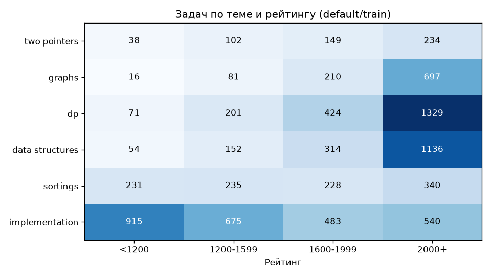

# EDA: задачи Codeforces для AlgoMind

## Датасет

[open-r1/codeforces](https://huggingface.co/datasets/open-r1/codeforces), `default/test`: 468 задач Codeforces 2024–2025 годов, 27 полей (условие, теги, рейтинг, editorial, тесты). Для EDA использована фиксированная ревизия. Выборка исследовательская: `test` не используется для настройки модели и базы практики (в `default/train` ещё 9 556 строк, их метаданные разобраны [ниже](#train)).

## Выводы

**Что в данных хорошо**
- Структура чистая: `id`, `title`, `description` заполнены везде, дублей по `id` и по тексту условия нет.
- Рейтинг и теги почти полные: пропущены у 2% и 1% задач.
- Широкий разброс сложности: рейтинг от 800 до 3500.

**Чего не хватает и какие риски**
- **Тесты.** Полные официальные тесты есть только у 21 задачи (4,5%). Флаг `executable` (448 задач) означает лишь прохождение имеющихся тестов, поэтому по этим данным нельзя надёжно проверять решения пользователя.
- **Разбор решений.** Editorial отсутствует у 208 задач (44%), эталонной оценки сложности (time/space) в данных нет.
- **Перекос по темам.** Частые теги (`greedy` 228, `math` 200) против редких (`graphs` 61, `two pointers` 37), теги пересекаются умеренно. Метрики классификатора нужно считать по каждой теме отдельно.
- **Узкий срез.** 83% задач 2024 года, четверть набора с рейтингом 800–1199. Для пилота этого мало как калибровки уровней.
- **Права.** Права на условия и коммерческое использование нужно проверять отдельно.

**Что это значит для проекта**
- Классификация тем — multi-label, у 94% задач два и больше тегов.
- Рекомендатору нужен рейтинг самой задачи, а не только тема: внутри темы разброс рейтинга большой, `dp` в среднем сложнее остальных.
- Для продуктового каталога тесты придётся готовить отдельно.
- Каталог для пилота по темам и сложности нужно набирать отдельно: простых задач по `two pointers`, `graphs`, `dp` мало.
- Условие занимает мало входа модели (медиана 900 символов), расчёт стоимости в основном зависит от RAG, кода и истории диалога.

## Графики

### Рейтинг



Задач с рейтингом 800–1199 — 116 (24,8%), дальше число задач плавно падает. У 10 задач рейтинга нет.

### Теги



Частоты сильно различаются, редкие темы дадут шумные метрики.



Две и больше тегов у 439 из 468 задач (94%), три и больше у 348 (74%), без тегов 5.



Медиана рейтинга `dp` 2300, `greedy` и `math` 1600, `implementation` и `brute force` 1800. Центральные 80% задач `dp` — рейтинг 1500–3100, у остальных тем 800–2900: простые задачи по `dp` редки.



Пересечения умеренные: максимум 0,27 у `greedy` + `data structures` и `greedy` + `math` (91 общая задача). Ни одна пара тем не дублирует другую, поэтому отдельные метрики по темам имеют смысл.

### Темы пилота и рейтинг



Для пилота нужны задачи одной сложности по каждой теме: 3 на входную и 3 на итоговую проверку плюс задачи для практики. Простых задач по темам пилота мало: ниже 1200 всего 4 по `two pointers`, 1 по `graphs` и 6 по `dp`. В диапазоне 1200–1999 их 22, 23 и 32. Тега для «массивов» в Codeforces нет. Одной этой выборки для пилота не хватает, ситуацию по `train` см. [ниже](#train).

### Пропуски



Почти пустые `interaction_format`, `aliases`, `generated_checker` — необязательные поля. Значимые для продукта пробелы: `editorial` (44%) и `note` (16%).

### Тесты и годы



Полные тесты у 21 задачи, 387 из 468 задач (83%) — 2024 года.

### Длина условия



Медиана 900 символов, 454 из 468 условий (97%) короче 2000, максимум 3062. Число токенов оценено по символам и в пилоте его нужно измерить.

<a id="train"></a>

## Дополнительно: `default/train`

Из 11 файлов `train` по HTTP прочитаны только колонки `id`, `aliases`, `contest_id`, `title`, `description`, `tags`, `rating` (около 12 МБ из 2,7 ГБ). Скрипт — [train.py](train.py), результаты — [train_results.json](train_results.json).

- 9 556 задач, дублей `id` нет. Теги есть у 9 407 (98%), рейтинг у 9 309 (97%). Контесты 2010–2024 годов, в 2024 году 481 задача.
- Теги редких тем встречаются достаточно часто для метрик по темам: `two pointers` встречается в 524 задачах, `graphs` в 1016.



В диапазоне 1200–1999 по темам пилота хватает задач: `two pointers` 251, `graphs` 291, `dp` 625, `sortings` 463. Ниже 1200 по `graphs` (16) и `two pointers` (38) задач по-прежнему мало. Вместо «массивов» подходит `sortings`: тема узкая, задач по ней поровну (около 230) на каждом уровне ниже 2000. `data structures` перекошена в сложные задачи, `implementation` слишком размыта.

**Пересечение с `test`** (468 задач):

| Проверка | Совпадений |
|---|---|
| Одинаковый `id` или алиас | 0 |
| Тот же контест | 0 |
| Одинаковый текст условия | 0 |
| Почти дубль (доля общих 5-словных фрагментов ≥ 0,5) | 0, максимум 0,36 |
| Одинаковое название | 26 (разные задачи с общими названиями) |

Наборы не пересекаются по задачам и контестам, но по времени `train` частично совпадает с `test` (2024 год). Переводы и варианты одной задачи внутри `train` не проверялись.

## Воспроизведение

Нужны Python 3.11+, сеть и `pyarrow` (при анализе 26.0.1). Исходные данные не копируются в репозиторий. Из каталога `algomind`:

```bash
python -m venv /tmp/algomind-eda
/tmp/algomind-eda/bin/pip install pyarrow==26.0.1
curl -L --fail -o /tmp/codeforces-test.parquet https://huggingface.co/datasets/open-r1/codeforces/resolve/fbe3f6e903ee854eec2e69e9d96d0306cde59baf/data/test-00000-of-00001.parquet
/tmp/algomind-eda/bin/python eda/analyze.py /tmp/codeforces-test.parquet > /tmp/algomind-results.json
diff -u eda/results.json /tmp/algomind-results.json

# train: только нужные колонки по HTTP (~12 МБ), нужен интернет
/tmp/algomind-eda/bin/pip install fsspec aiohttp
/tmp/algomind-eda/bin/python eda/train.py /tmp/codeforces-test.parquet | diff -u eda/train_results.json -

# графики строятся из results.json и train_results.json, датасет не нужен
/tmp/algomind-eda/bin/pip install matplotlib==3.11.2
/tmp/algomind-eda/bin/python eda/plots.py   # -> eda/figures/*.png
```

SHA-256 файла: `f3e241f6a111822aed1ee6800d3d3f73917ea4d10e70e264b47a7bcdba4cbf31`. Скрипт проверяет число строк и полей, `diff` — хеш и все результаты. В [results.json](results.json) — полные распределения и пропуски по всем 27 полям. Под пропуском считаем `null`, пустую строку или список; ноль и `false` не пропуски.
